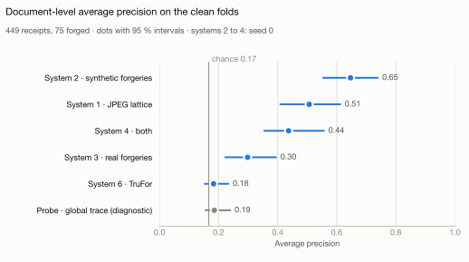

# AI-Based Expert System for Detecting Fraud in Financial Documents

[](https://github.com/sadikemreikiz/financial-document-fraud-detection/actions/workflows/ci.yml)

Explainable detection of forged receipts from the evidence they carry: pixel forensics and
accounting-rule verification, with an LLM-assisted review planned, evaluated on real human
forgeries.

## At a glance

- **What it does:** detects forged receipts from the evidence they carry: arithmetic on the
  receipt that no longer adds up, and traces of editing in its pixels. An LLM-assisted review is
  planned.
- **What stands out:** I audited my own thesis, found that data leakage had invalidated its
  results, and rebuilt it under an evaluation protocol fixed before any model was trained. Along
  the way I found a shortcut in the dataset: a rule that looks only at the file format beats the
  best published result (F1 79.3 against 28.39), so every image is normalised before any model
  sees it.
- **Result so far:** a model trained only on forgeries from my own synthetic engine finds real
  human forgeries it has never seen with an average precision of 0.65 (chance 0.17), and points
  to the edited region on 69 % of them, in a single pre-registered measurement on held-out folds.
- **Built with:** Python 3.14, PyTorch, scikit-learn, RapidOCR, pytest, mypy in strict mode and
  CI on every pull request.
- **Status:** Phases 0 to 4 of 8 complete; next, an LLM reads the receipt fields and is
  measured against the rule-based parser, before Phase 5 combines the evidence.

<picture>
  <source media="(prefers-color-scheme: dark)" srcset="reports/forensics/figures/clean-precision-dark.svg">
  
</picture>

How well each pixel-forensics system ranks the 75 forged receipts among 449 that no person had
viewed, in the single measurement of Phase 4 ([Phase 4 results](reports/forensics/README.md)).

This repository is **v2** of my M.Sc. thesis (University of Europe for Applied Sciences, Berlin,
2026). It is a rebuild from scratch: when I reviewed the thesis implementation after
submission, I found that its headline results were not valid, and v2 is designed to answer the
same research questions properly. See [From thesis to v2](docs/thesis-review.md).

## Status

**Under active development.** Phases 0 to 4 of the [roadmap](docs/project-charter.md#roadmap)
are complete: foundations, data, reading, accounting rules and pixel forensics. Phase 5 combines
the evidence: copy-move detection, linking pixel evidence to the fields it changes, fusion with
the accounting rules and a decision policy. The test split stays locked until the final
evaluation of Phase 7.

## Findings so far

- **The dataset carries a format shortcut.** 63 % of the forged images have an alpha channel and
  none of the authentic ones do. That one rule reaches F1 79.3 on the test split, against 28.39
  for the best published result. Every image is normalised to grayscale without alpha before
  any system sees it ([data audit](reports/data/findit2-audit.md)).
- **The thesis implementation leaked.** 89 of the 126 documents its fusion was tested on (71 %)
  had been in the training set of the image model it used
  ([thesis review](docs/thesis-review.md)).
- **The published baseline is reproduced.** Under a protocol fixed before any model was trained,
  the test split was opened once to reproduce the published BoW + LR baseline: F1 18.18 against
  the paper's 17.78 ([report](reports/baselines/bow-lr.md)).
- **Every claim must beat a floor.** Marking every test receipt as forged already reaches F1
  27.7, within a point of the best published 28.39, so a claim against published work must also
  beat chance on recall at a 10 % review budget
  ([ADR-0013](docs/decisions/0013-success-criterion-and-floors.md)).
- **Accounting rules rank forgeries, but reading limits them.** Measured once on validation,
  on the dataset's transcripts, they reach an average precision of 36.5 (chance 17.4), and
  reviewing the 10 % most suspicious receipts finds 29.7 % of the forgeries (chance 10 %). Most of their false alarms come from
  reading errors, not from the receipts ([Phase 3 results](reports/rules/README.md)).
- **Real edits are hard to see.** At 100 % zoom, I found 2 of the 45 edited regions of the
  receipts studied for Phase 4 ([Phase 4 results](reports/forensics/README.md)).
- **Synthetic forgeries train the best pixel detector.** Every Phase 4 system was measured once,
  together, on 449 receipts no person had viewed. Adding synthetic forgeries to the real ones
  raises the average precision by 0.14 (95 % interval 0.06 to 0.24), the comparison fixed in
  advance; trained on synthetic forgeries alone, the model reaches 0.65 against 0.30 for the
  real ones alone and 0.18 for TruFor, a pretrained forensic model
  ([report](reports/forensics/clean-measurement.md)).
- **The detectors find the edit, not a shortcut.** The most suspicious region of the best model
  hits the edit on 69 % of the forged receipts, where a random box of the same size hits 3 %,
  and a probe over 28 global properties of the images finds no trace of forgery
  ([Phase 4 results](reports/forensics/README.md)).

## How the work is done

- An [evaluation protocol](docs/evaluation-protocol.md) fixed before any model was trained, a
  test split that code can open only with a recorded unlock, and measurement rules written
  before the outputs they judge.
- A [decision record](docs/decisions/README.md) for every significant choice, including the
  ones changed after a result was seen, with the reason.
- Every number in a report is generated by code from data and run records; `make
  check-reports` fails if a committed report differs from its regeneration, and CI checks the
  reports that need no dataset. Negative results are reported like positive ones.
- Code in Python 3.14, checked by ruff, mypy in strict mode and pytest in CI.

## Documentation

| Document | Contents |
|---|---|
| [Project charter](docs/project-charter.md) | Goals, non-goals, research questions, success criteria, roadmap |
| [Evaluation protocol](docs/evaluation-protocol.md) | Pre-registered metrics, tracks, test-set lock and claim rules |
| [Architecture](docs/architecture.md) | Layers, data model and extension points |
| [Decision records](docs/decisions/README.md) | Why each significant choice was made |
| [Data card](docs/data-card.md) and [data audit](reports/data/findit2-audit.md) | The dataset, its known issues and the shortcut analysis |
| [Annotation guidelines](docs/annotation-guidelines.md) | How the gold sets for field extraction are drawn, annotated and verified |
| [Phase 2 results](reports/reading/README.md) | OCR choice, field extraction accuracy on two gold sets, known limitations |
| [Phase 3 results](reports/rules/README.md) | Published baseline reproduced, accounting rules measured once on validation |
| [Phase 4 results](reports/forensics/README.md) | Pre-registration, real forgeries, reference systems, synthetic engine, learned models, one clean measurement |
| [From thesis to v2](docs/thesis-review.md) | Code-verified review of the original implementation |

## Development

Requires [uv](https://docs.astral.sh/uv/).

```bash
make install   # create the environment and install git hooks
make check     # lint, type check and test, as in CI
make data      # download, verify and prepare the dataset
make test-data # checks on the real dataset
make reports   # regenerate the reports from the dataset, annotations and run records
make check-reports  # fail if a committed report differs from its regeneration
```

The models of Phase 4 run on the Apple GPU, whose outputs differ slightly from a processor's, so
their reports are regenerated by their own targets: `make trufor`, `make learned` and
`make clean-measurement`, then `make figures` for the figures.

Reports derived from run records (`reports/runs`) or recorded reviews are also checked in CI.
The gold evaluations in `reports/reading` were produced by the parser version named in each
report and are reproduced as described in the [Phase 2 results](reports/reading/README.md).

## Licence

Code is released under the [MIT licence](LICENSE). Datasets are not redistributed; they are
downloaded from their original sources and verified by checksum. Phase 4 uses third-party
models under their own terms: TruFor for nonprofit research, credited to its authors, and
ImageNet-trained weights, which limit the models trained from them to non-commercial research.
