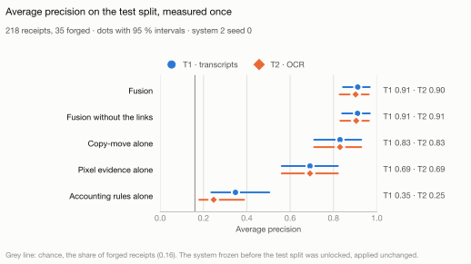

# Finding forged receipts, and showing why

[](https://github.com/sadikemreikiz/financial-document-fraud-detection/actions/workflows/ci.yml)

Explainable detection of forged receipts from the evidence they carry: pixel forensics and
accounting-rule verification, with an LLM that reads the fields and drafts the case for a human
reviewer, evaluated on real human forgeries. Version 2 of my M.Sc. thesis, *AI-Based Expert
System for Detecting Fraud in Financial Documents* (University of Europe for Applied Sciences,
Berlin, 2026), rebuilt from scratch and measured on receipts only.

**[Live demo](https://sadikemreikiz.github.io/financial-document-fraud-detection/)**: ten receipts of the
locked test split, the system's evidence on each and the results, as recorded.

## At a glance

- **What it does:** detects forged receipts from the evidence they carry: arithmetic on the
  receipt that no longer adds up, and traces of editing in its pixels. An LLM that reads the
  receipt's fields replaced the rule-based parser after a pre-registered test of the accounting
  rules' false alarms, and an LLM agent drafts the case file of each receipt sent to review.
- **What stands out:** I audited my own thesis, found that data leakage had invalidated its
  results, and rebuilt it under an evaluation protocol fixed before any model was trained. Along
  the way I found a shortcut in the dataset: a rule that looks only at the file format beats the
  best published result I know of (F1 79.3 against 28.39, where marking every receipt as forged
  reaches 27.7), so every image is normalised before any model sees it.
- **Result:** measured once on the 218 receipts of the locked test split, combining copy-move
  detection, pixel forensics and the accounting rules ranks forged receipts with an average
  precision of 0.90 from the image alone (chance 0.16) and reaches an F1 of 0.81 (95 % interval
  0.68 to 0.91), against 0.28 for the best published result I know of (ChatGPT reading only the
  transcripts; this system also reads the image); at a 10 % review budget all 24 receipts sent to
  review are forged, and the first region an audit report shows hits the edit or its copy
  source on 33 of the 35 forgeries. Saved again as JPEG at quality 95, the same receipts fall to
  0.61: the system relies on lossless files. The pixel model behind it was trained only on
  forgeries from my own synthetic engine.
- **Built with:** Python 3.14, PyTorch, scikit-learn, RapidOCR, the Claude API, Claude Code,
  pytest, mypy in strict mode and CI on every pull request.
- **Status:** Phases 0 to 7 of 8 complete: the single evaluation on the locked test split
  ([Phase 7 results](reports/README.md)), the [model card](docs/model-card.md), which states
  where the system fails, the [public demo](https://sadikemreikiz.github.io/financial-document-fraud-detection/)
  and the [thesis review](docs/thesis-review.md). Phase 8, the career package, remains.

<picture>
  <source media="(prefers-color-scheme: dark)" srcset="reports/fusion/figures/test-precision-dark.svg">
  
</picture>

How well the fused system and each source alone rank the 35 forged receipts among the 218 of the
test split, measured once in Phase 7 ([Phase 7 results](reports/README.md)). The validation check
of Phase 5 is in the [Phase 5 results](reports/fusion/README.md), and Phase 4's measurement of the
pixel systems in the [Phase 4 results](reports/forensics/README.md).

This repository is **v2** of my M.Sc. thesis (University of Europe for Applied Sciences, Berlin,
2026). It is a rebuild from scratch: when I reviewed the thesis implementation after
submission, I found that its headline results were not valid, and v2 is designed to answer the
same research questions properly. See [From thesis to v2](docs/thesis-review.md).

## Status

**Under active development.** Phases 0 to 6 of the [roadmap](docs/project-charter.md#roadmap)
are complete: foundations, data, reading, accounting rules, pixel forensics, fusion and the
language-model layer; Phase 7's evaluation on the test split is done. Reading errors
cause most false alarms of the accounting rules, so LLM field extraction moved before Phase 5
([ADR-0024](docs/decisions/0024-llm-extraction-before-fusion.md)). Its measurement was fixed in
advance ([ADR-0025](docs/decisions/0025-llm-extraction-preregistration.md)): the LLM points to
the numbers in the receipt text and code takes the values, the model and instruction were
developed on one gold set, and a second gold set, adjudicated by the owner, decided once. The
LLM did not pass ([report](reports/llm/gold-b.md)). A second test, fixed after that result,
counted the accounting rules' false alarms with each reader on 482 training receipts
([ADR-0027](docs/decisions/0027-llm-reader-judged-by-false-alarms.md)): with the LLM's fields they fall from 37 % to
18 % of authentic receipts on the transcripts and from 39 % to 31 % on our OCR, so the LLM reads
the fields from here on ([report](reports/llm/false-alarms.md)). Phase 5 combined the evidence:
copy-move detection, links between pixel evidence and the fields it changes, fusion with the
accounting rules, a review policy and an audit report; it was fixed in advance
([ADR-0029](docs/decisions/0029-fusion-preregistration.md)), frozen and checked once on the
validation split ([Phase 5 results](reports/fusion/README.md)). Phase 6b set a language model
against that system as a detector and built an agent that drafts the case file of a receipt sent
to review, both fixed in advance
([ADR-0031](docs/decisions/0031-llm-detector-and-agent.md)) and checked once on the validation
split ([Phase 6 results](reports/llm/README.md)). Phase 7 unlocked the test split once, as fixed
in advance ([ADR-0034](docs/decisions/0034-phase-7-preregistration.md)), and measured every system
on it ([Phase 7 results](reports/README.md), [model card](docs/model-card.md)); the
[public demo](https://sadikemreikiz.github.io/financial-document-fraud-detection/) shows ten of the test
receipts, and the owner approved the [thesis review](docs/thesis-review.md) on 2026-10-30.

## Findings so far

- **The dataset carries a format shortcut.** 63 % of the forged images have an alpha channel and
  none of the authentic ones do. That one rule reaches F1 79.3 on the test split, against 28.39
  for the best published result I know of and 27.7 for marking every receipt as forged. Every
  image is normalised to grayscale without alpha before any system sees it
  ([data audit](reports/data/findit2-audit.md)).
- **The thesis implementation leaked.** 89 of the 126 documents its fusion was tested on (71 %)
  had been in the training set of the image model it used
  ([thesis review](docs/thesis-review.md)).
- **The published baseline is reproduced.** Under a protocol fixed before any model was trained,
  the test split was opened once to reproduce the published BoW + LR baseline: F1 18.18 against
  the paper's 17.78 ([report](reports/baselines/bow-lr.md)).
- **Every claim must beat a floor.** Marking every test receipt as forged already reaches F1
  27.7, within a point of the best published 28.39, so a claim against published work must also
  beat chance on recall at a 10 % review budget
  ([ADR-0013](docs/decisions/0013-success-criterion-and-floors.md)).
- **Accounting rules rank forgeries, but reading limits them.** Measured once on validation,
  on the dataset's transcripts, they reach an average precision of 36.5 (chance 17.4), and
  reviewing the 10 % most suspicious receipts finds 29.7 % of the forgeries (chance 10 %). Most of their false alarms come from
  reading errors, not from the receipts ([Phase 3 results](reports/rules/README.md)).
- **Real edits are hard to see.** At 100 % zoom, I found 2 of the 45 edited regions of the
  receipts studied for Phase 4 ([Phase 4 results](reports/forensics/README.md)).
- **Synthetic forgeries train the best pixel detector.** Every Phase 4 system was measured once,
  together, on 449 receipts no person had viewed. Adding synthetic forgeries to the real ones
  raises the average precision by 0.14 (95 % interval 0.06 to 0.24), the comparison fixed in
  advance; trained on synthetic forgeries alone, the model reaches 0.65 against 0.30 for the
  real ones alone and 0.18 for TruFor, a pretrained forensic model
  ([report](reports/forensics/clean-measurement.md)).
- **The detectors find the edit, not a shortcut.** The most suspicious region of the best model
  hits the edit or its copy source on 69 % of the forged receipts, where a random box of the
  same size hits 3 %, and a probe over 28 global properties of the images finds no trace of
  forgery ([Phase 4 results](reports/forensics/README.md)).
- **An LLM reader cuts the rules' false alarms.** With the fields Claude Sonnet 5.5 points to in
  the transcripts, the accounting rules flag 18 % of 404 authentic receipts, against 37 % with
  the rule-based parser, and catch 44 % of the forged ones, against 54 %, in one test fixed
  in advance. A first test, by exact reading on 30 owner-adjudicated receipts, could not
  tell the two readers apart, and the development set had overstated the LLM: 88 % of receipts
  read exactly there, 30 % on the adjudicated set ([record](docs/llm-development.md#second-test-false-alarms-2026-10-23)).
- **Combining the evidence beats every single source.** Checked once on the validation split,
  the fused system reaches an average precision of 0.85 on the transcripts and 0.83 on OCR text,
  above copy-move detection alone (0.75), pixel forensics alone (0.66) and the accounting rules
  alone (0.39 and 0.32), each by a paired-bootstrap interval above zero
  ([report](reports/fusion/validation-check.md)); on the test split the margin over copy-move is
  no longer above zero, as below.
- **Linking pixels to fields adds little that can be shown.** Without the two links the fused
  system loses 0.022 (0.0002 to 0.048) on the transcripts and 0.011 (−0.011 to 0.035) on OCR
  text ([Phase 5 results](reports/fusion/README.md)).
- **The audit report shows where to look, and states only evidence.** Its first region hits the
  edit on 30 of the 33 forged validation receipts, where a random box hits about 5 % of the time,
  and an independent checker found every one of the 16,496 numbers and boxes in 380 reports in
  the evidence ([report](reports/fusion/validation-check.md)).
- **A general LLM detects far worse than the specialised system.** Asked to score each
  validation receipt from its page and OCR text, Claude Sonnet 5.5 reaches an average precision
  of 0.47 and Claude Opus 5.5 0.67, against 0.83 for the fused system on the same text; the
  difference to Sonnet, the comparison named in advance, is 0.36 (0.20 to 0.51)
  ([report](reports/llm/detector/validation.md)).
- **The review agent's case files rest on its tools' outputs, at about 2 cents a receipt.** On the 19
  validation receipts sent to review, 5 of the 1,224 numbers and boxes in its case files were
  not found in the tool outputs, and its first observation pointed at the edit on all 19, as the
  audit report does ([report](reports/llm/agent/validation.md)).
- **On the test split, the success criterion is met.** Measured once with everything frozen on
  the validation split, fusion reaches an F1 of 0.814 (0.679 to 0.906) on both text sources,
  against 0.284 for the best published result I know of (ChatGPT, transcripts only) and 0.277
  for flagging every receipt, and an average precision of 0.912 on the transcripts and 0.902 on
  OCR text; all 24 receipts sent to review at the 10 % budget are forged, and every audit report
  is grounded ([Phase 7 results](reports/README.md)).
- **There, fusion does not clearly beat copy-move alone.** Its margin is 0.072 (−0.004 to
  0.155) on OCR text, so the claim that it beats every single source is not made, and linking
  adds nothing that can be measured ([report](reports/fusion/test-check.md)).
- **The system relies on lossless files.** Saved again as JPEG at quality 95, the test receipts
  fall from an average precision of 0.902 to 0.607, and at 75 to 0.414: copy-move needs regions
  identical pixel for pixel ([report](reports/fusion/track-r.md)).
- **A general LLM stays far behind on the test split.** Claude Sonnet 5.5 reaches an average
  precision of 0.447 and Claude Opus 5.5 0.692, against 0.902 for fusion on the same text; the
  difference to Sonnet, named in advance, is 0.455 (0.314 to 0.587)
  ([report](reports/llm/detector/test.md)).
- **One command failed after the unlock and was fixed by the rule fixed in advance.** It read a
  text source track R does not use; the fix changed what it reads and nothing else, and is
  disclosed ([Phase 7 results](reports/README.md#the-one-fix-after-the-unlock)).

## How the work is done

- An [evaluation protocol](docs/evaluation-protocol.md) fixed before any model was trained, a
  test split that code can open only with a recorded unlock, and measurement rules written
  before the outputs they judge.
- A [decision record](docs/decisions/README.md) for every significant choice, including the
  ones changed after a result was seen, with the reason.
- Every number in a report is generated by code from data and run records; `make
  check-reports` fails if a committed report differs from its regeneration, and CI checks the
  reports that need no dataset. Negative results are reported like positive ones.
- Code in Python 3.14, checked by ruff, mypy in strict mode and pytest in CI.

## Documentation

| Document | Contents |
|---|---|
| [Project charter](docs/project-charter.md) | Goals, non-goals, research questions, success criteria, roadmap |
| [Evaluation protocol](docs/evaluation-protocol.md) | Pre-registered metrics, tracks, test-set lock and claim rules |
| [Architecture](docs/architecture.md) | Layers, data model and extension points |
| [Decision records](docs/decisions/README.md) | Why each significant choice was made |
| [Data card](docs/data-card.md) and [data audit](reports/data/findit2-audit.md) | The dataset, its known issues and the shortcut analysis |
| [Annotation guidelines](docs/annotation-guidelines.md) | How the gold sets for field extraction are drawn, annotated and verified |
| [Phase 2 results](reports/reading/README.md) | OCR choice, field extraction accuracy on two gold sets, known limitations |
| [Phase 3 results](reports/rules/README.md) | Published baseline reproduced, accounting rules measured once on validation |
| [Phase 4 results](reports/forensics/README.md) | Pre-registration, real forgeries, reference systems, synthetic engine, learned models, one clean measurement |
| [Phase 5 results](reports/fusion/README.md) | Copy-move, linking, fusion, review policy and audit report, checked once on the validation split |
| [Phase 6 results](reports/llm/README.md) | The LLM field reader, the LLM as a detector against the fused system, and the review agent, each checked once |
| [Phase 7 results](reports/README.md) | The single evaluation on the test split: the claims, robustness to re-saved images, every error and the one fix after the unlock |
| [Model card](docs/model-card.md) | What the system is, what it was measured on, how well, and where it fails |
| [From thesis to v2](docs/thesis-review.md) | Code-verified review of the original implementation |

## Development

Requires [uv](https://docs.astral.sh/uv/).

```bash
make install   # create the environment and install git hooks
make check     # lint, type check and test, as in CI
make data      # download, verify and prepare the dataset
make test-data # checks on the real dataset
make reports   # regenerate the reports from the dataset, annotations and run records
make check-reports  # fail if a committed report differs from its regeneration
```

The models of Phase 4 run on the Apple GPU, whose outputs differ slightly from a processor's, so
their reports are regenerated by their own targets: `make trufor`, `make learned` and
`make clean-measurement`, then `make figures` for the figures.

Reports derived from run records (`reports/runs`) or recorded reviews are also checked in CI.
The gold evaluations in `reports/reading` were produced by the parser version named in each
report and are reproduced as described in the [Phase 2 results](reports/reading/README.md).

## Licence

Code is released under the [MIT licence](LICENSE). Datasets are not redistributed; they are
downloaded from their original sources and verified by checksum. Phase 6 sends receipt text
and, in 6b, normalised page images and crops of them to the Claude API for processing; what is
sent and kept is recorded in the
[data card](docs/data-card.md#use-with-a-hosted-language-model). Phase 4 uses third-party
models under their own terms: TruFor for nonprofit research, credited to its authors, and
ImageNet-trained weights, which limit the models trained from them to non-commercial research.

## Contact

**Sadik Emre Ikiz** · Open to Applied AI and ML Engineer roles · Berlin

[LinkedIn](https://www.linkedin.com/in/sadikemreikiz/) · [GitHub](https://github.com/sadikemreikiz) ·
[sadikemreikiz90@gmail.com](mailto:sadikemreikiz90@gmail.com)
