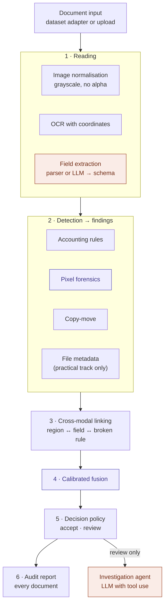

# Architecture

This is the target architecture. It is implemented phase by phase (see the
[project charter](project-charter.md#roadmap)); sections describe intent until the corresponding
phase is complete. The rationale is in [ADR-0005](decisions/0005-evidence-based-architecture.md)
and [ADR-0006](decisions/0006-llm-placement.md).

## Implementation status

| Layer | Status |
|---|---|
| Data (Phase 1) | Done: Find-it-again adapter, normalisation, test lock, audits |
| Reading (Phase 2) | Done: RapidOCR behind `OcrEngine`, rule-based parser (v2), gold-set evaluation ([results](../reports/reading/README.md)). Since Phase 6a the parser also records where each value is printed (`FieldSources`: row, characters, segments, box), with the values of parser v2 unchanged |
| Evaluation and baselines (Phase 3) | Done: run records, stored folds, pre-registered metrics with floors, BoW + LR reproduced ([results](../reports/rules/README.md)) |
| Detection: accounting rules (Phase 3) | Done: six rules with worded verdicts, scored by logistic regression. Since Phase 5 a failing rule becomes a `Finding`, located at the values it reads |
| Pixel forensics (Phase 4) | Done: pre-registration ([ADR-0014](decisions/0014-pixel-forensics-preregistration.md)), viewing lock of the design fold, [observation form and page](forgery-observation-guide.md), [benign mark boxes and check page](benign-marks-guide.md), measurement rules ([ADR-0015](decisions/0015-pixel-measurement-rules.md)), system 1 the JPEG-lattice map ([ADR-0016](decisions/0016-system-1-jpeg-trace.md), [ADR-0017](decisions/0017-size-check-on-evidence.md)), the global-trace probe ([ADR-0018](decisions/0018-global-trace-probe.md)), TruFor as system 6 ([ADR-0019](decisions/0019-system-6-trufor.md), [record](system-6-development.md)), one clean measurement ([ADR-0020](decisions/0020-clean-folds-measured-together.md), [record](clean-measurement.md)), the synthetic forgery engine ([ADR-0021](decisions/0021-synthetic-forgery-engine.md), [record](synthetic-engine-development.md)), the learned models ([ADR-0022](decisions/0022-learned-models.md), [record](learned-models-development.md)); [results](../reports/forensics/README.md) |
| LLM field extraction (Phase 6a) | Done: pre-registered ([ADR-0024](decisions/0024-llm-extraction-before-fusion.md), [ADR-0025](decisions/0025-llm-extraction-preregistration.md), [ADR-0026](decisions/0026-adjudication-of-items-and-tax-rows.md)), built ([below](#llm-field-reader-phase-6a)) and measured once on gold set B, where the LLM reader did not pass on either text source ([report](../reports/llm/gold-b.md), [record](llm-development.md#gold-set-b-2026-10-23)); in a second test, by the accounting rules' false alarms on 482 training receipts ([ADR-0027](decisions/0027-llm-reader-judged-by-false-alarms.md)), it passed on both, so Phase 5 reads fields with the LLM ([report](../reports/llm/false-alarms.md), [record](llm-development.md#second-test-false-alarms-2026-10-23)); the use of the data is recorded in the [data card](data-card.md#use-with-a-hosted-language-model) |
| Copy-move (Phase 5) | Pre-registered ([ADR-0029](decisions/0029-fusion-preregistration.md), [ADR-0030](decisions/0030-copy-move-reports-a-pair.md)); developed on the design fold ([record](copy-move-development.md)); measured once on the clean folds ([report](../reports/fusion/copy-move-clean.md)) |
| Findings, linking, file-metadata check (Phase 5) | Built: the `Finding` contract and each detector's findings ([`finding.py`](../src/docfraud/detectors/finding.py)), the two kinds of link ([`docfraud.linking`](../src/docfraud/linking/)) and the check of track T3 ([`metadata.py`](../src/docfraud/detectors/metadata.py)) |
| Fusion and decision policy (Phase 5) | Built, not yet fitted on receipts: the inputs from findings, the fusion model with out-of-fold fitting, Platt scaling and its checks ([`docfraud.fusion`](../src/docfraud/fusion/)), and the review policy ([`decision.py`](../src/docfraud/decision.py)) |
| Reporting | Pre-registered ([ADR-0029](decisions/0029-fusion-preregistration.md)), not built yet (Phase 5) |
| Investigation agent | Not started (Phase 6b) |

## Overview

Purple components are trained models, orange components use an LLM, everything else is
deterministic code.

## Core data model

| Type | Meaning |
|---|---|
| `Document` | One document instance: identifier, source dataset and source document identity, image, optional transcript, label and annotated regions when known, split assignment |
| `Token` | A recognised word with its bounding box and confidence |
| `ReceiptFields` | Structured content (line items, subtotal, tax, rounding, total, tendered, change, dates, merchant) where each value keeps a reference to its source tokens |
| `Finding` | One piece of evidence: detector, type, score, location (bounding boxes and/or fields), human-readable reason and machine-readable details |
| `Assessment` | Calibrated fraud probability, decision, and the findings that support it |

`Finding` is the contract between layers. Detectors produce findings, linking relates them,
fusion consumes them and reporting renders them. A report cannot state anything that is not a
finding.

## LLM field reader (Phase 6a)

How the LLM reads a receipt, and what code guarantees on the way
([ADR-0024](decisions/0024-llm-extraction-before-fusion.md),
[ADR-0025](decisions/0025-llm-extraction-preregistration.md)):

1. **Rows and labels.** `docfraud.reading` builds the rows the parser reads: transcript lines
   placed on OCR boxes for T1, OCR tokens for T2. `docfraud.llm.labels` marks every number, with
   its sign, and every date with a short label such as `⟦n12⟧` or `⟦d1⟧`.
2. **Request.** A fixed instruction, the numbered rows and the answer form (a closed JSON schema)
   make one `Request`, identified by a hash of everything that can change its answer. Each
   command checks which receipts it may read before it builds a request.
3. **Provider.** `ClaudeProvider` implements the `Provider` interface, sending requests one by
   one (timed) or through the batch service (half the price). A submitted batch is remembered
   until its results are in and its polls wait out a lost connection, so a stopped run collects
   it instead of paying for it twice. `Runner` sends only requests
   without a stored answer (`ResponseStore`), pays a small pilot first, projects the cost of the
   rest and stops before the spending limit; `Ledger` records every cost.
4. **Reader.** The answer names labels and rows, never values. `docfraud.llm.reader` takes each
   value from the labelled text, with its row, characters and box, so a forged value is read as
   printed. A reference that does not exist or holds the wrong kind of value leaves the field
   empty and is counted as a rejection.
5. **Measurement.** The model is chosen and the instruction developed on gold set A only, and
   the best round is frozen. Gold set B is read once, while the reader code is unchanged since
   the freeze; the values in dispute are decided by the owner on a page that shows no candidate
   before the first answer, and only then is the pre-registered rule applied, per text source.
6. **Use from Phase 5 on.** The LLM reader passed ADR-0027 on both text sources, so later
   phases take fields from `FrozenReader` (`docfraud.llm.frozen`). It rebuilds the frozen
   version's request for a receipt and reads the stored answer; it never sends a request, and a
   receipt without an answer is an error. The answers are paid for once, by the commands that
   read a split: the training receipts in Phase 6a, the validation receipts by
   `read-validation`, the test receipts in Phase 7.

| Command (`docfraud llm …`) | Step |
|---|---|
| `compare-models` | Model choice on gold set A, from the cheapest up |
| `develop`, `freeze`, `stability` | Development rounds on gold set A, the frozen version, its run-to-run stability |
| `measure-b`, `adjudicate`, `evaluate-b` | The one reading of gold set B, its adjudication, the decision report |
| `false-alarms` | The one reading of the training receipts outside both gold sets, judged by the accounting rules' false alarms ([ADR-0027](decisions/0027-llm-reader-judged-by-false-alarms.md)) |
| `read-validation` | The one reading of the validation receipts for Phase 5; it records the version, the commit and the cost, and measures nothing |
| `spending` | What has been spent, against the limit |

## Package layout

| Module | Responsibility | Phase |
|---|---|---|
| `docfraud.data` | Dataset adapters, the `Document` model, split handling with the test lock | 1 |
| `docfraud.reading` | Image normalisation, OCR, field extraction | 2 |
| `docfraud.detectors` | Accounting rules, copy-move, file metadata | 3, 5 |
| `docfraud.forensics` | Pixel forensics: the JPEG-lattice map, TruFor, the global-trace probe, the learned models and their rounds, the clean measurement and its report | 4 |
| `docfraud.baselines` | Published baselines, re-implemented to anchor results to prior work | 3 |
| `docfraud.evaluation` | Metrics, bootstrap, cross-validation, run records | 3 |
| `docfraud.synthesis` | Synthetic forgery engine (training data only) | 4 |
| `docfraud.linking` | Cross-modal evidence linking | 5 |
| `docfraud.fusion` | Calibration and fusion models | 5 |
| `docfraud.decision` | Decision policy | 5 |
| `docfraud.reporting` | Audit reports | 5 |
| `docfraud.llm` | Provider interface, LLM extraction (6a), investigation agent (6b) | 6a, 6b |
| `docfraud.api`, `docfraud.cli` | HTTP API and command line | 0, 7 |

Modules are created when their phase starts, not before.

## Extension points

| To add | Implement | Nothing else changes because |
|---|---|---|
| A dataset | A dataset adapter that yields `Document`s | Detectors only see `Document`s; documents without transcripts are read by OCR |
| An accounting rule | A rule function with tests | The rule engine collects rules from a registry |
| A document type (e.g. invoices) | A field schema and parser profile | Rules operate on structured fields |
| A detector | The detector interface, emitting `Finding`s | Fusion learns the new evidence's weight on the training split, from out-of-fold scores ([ADR-0028](decisions/0028-fusion-fitted-on-the-training-split.md)) |
| An OCR engine or LLM provider | The respective interface | Callers depend on the interface only |
