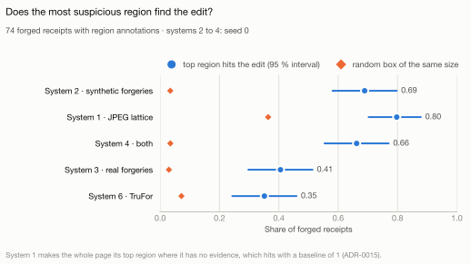

# Phase 4 results: pixel forensics

This page summarises Phase 4 and links the generated reports behind every number. It is written
by hand; when a number here and a generated report disagree, the generated report is right.

## Results on the clean folds

Every system was measured once, together, on the four clean folds that no person viewed in
Phase 4: 449 receipts of the training split, 75 of them forged
([report](clean-measurement.md), [record](../../docs/clean-measurement.md)). The numbers are
cross-validated on the training split; the test split stays locked until Phase 7, so no claim
against published work is made here.

<picture>
  <source media="(prefers-color-scheme: dark)" srcset="figures/clean-precision-dark.svg">
  
</picture>

<picture>
  <source media="(prefers-color-scheme: dark)" srcset="figures/clean-localisation-dark.svg">
  
</picture>

The figures are drawn by `make figures` from the measurement's results; the report's tables are
their table view.

- **RQ5: synthetic forgeries help.** Adding synthetic forgeries to the real ones (system 4
  against system 3) raises the average precision by 0.139 (95 % interval 0.056 to 0.242), the
  comparison fixed in advance; without the 98 receipts of earlier contact the gain is 0.206.
  Trained on synthetic forgeries alone, system 2 beats the real ones by 0.348 (0.243 to 0.443).
- **The best system is the one trained on synthetic forgeries only.** System 2 reaches an
  average precision of 0.647 (0.554 to 0.739) against a chance level of 0.167, a ROC-AUC of
  0.849, and an F1 of 0.573 at its validation threshold against the floor of 0.286; reviewing
  its 10 % most suspicious receipts finds 45 % of the forgeries. Its three seeds agree within
  0.03. That it also beats system 4 (0.437) was not a comparison fixed in advance, so it is
  stated, not claimed.
- **The systems find the edits, not a shortcut.** On the 74 forged receipts with region
  annotations, system 2's most suspicious region hits the edit or its copy source (shares at
  least a pixel with either) on 69 %, where a random box of the same size hits 3 %; every system
  with a map passes the localisation guard. The global-trace probe finds no trace of forgery in
  28 global properties of the receipts (average precision 0.186, chance 0.167), and no system's
  score follows it (rank correlations 0.03 to 0.13).
- **Pixel forensics sees what the accounting rules cannot.** On the 31 forged receipts whose
  edits avoid amounts and products, measured against every authentic receipt, system 2 reaches
  an average precision of 0.482 against a chance level of 0.077, and its 10 % review budget
  finds 52 % of them.
- **The classical trace holds; the pretrained model does not.** System 1, the JPEG-lattice map
  without training, reaches 0.507 although it has evidence on only 49 of the 75 forged receipts
  and on no page scan. TruFor, trained elsewhere, stays near chance (0.183, 0.153 to 0.233) and
  flags mostly authentic receipts.
- **The design fold did not flatter.** Systems 1, 2 and 3 score on the clean folds as on the
  design fold (0.507, 0.647 and 0.298 against 0.500, 0.601 and 0.295); system 4 (0.437 against
  0.602) and TruFor (0.183 against 0.270) score lower.

### Limits of these results

- Cross-validated numbers on the training split; the success criterion of ADR-0013 is judged on
  the test split in Phase 7.
- The size check of ADR-0015, descriptive on the clean folds, finds the score of system 3
  growing with receipt size on three of four folds and that of system 4 on one; system 2's and
  TruFor's do not.
- At the 10 % budget system 2 flags 11 of the 23 authentic receipts with digital annotations,
  which are digital edits, though benign; Phase 5's decision policy has to account for them.
- No system finds the source of a copy, which Phase 5's copy-move detection is for.
- The conventions and limitations that ADR-0022 lists for the learned models stand beside every
  number (the [report](clean-measurement.md) states them).

## 4.1 Pre-registration

[ADR-0014](../../docs/decisions/0014-pixel-forensics-preregistration.md) fixes how pixel
forensics is developed and measured before any receipt was viewed for it. Fold 2 of the training
split is the **design fold** (19 forged and 94 authentic receipts): only its receipts may be
viewed. The other four folds are the **clean folds** (449 receipts, 75 forged), on which each
pre-registered system is measured once. A viewing lock in code
([`design_fold.py`](../../src/docfraud/evaluation/design_fold.py)) refuses to show a person any
image, crop or mask of a clean-fold receipt. Every number behind the record is regenerated in
[preregistration-data.md](preregistration-data.md).

## 4.2 What the real forgeries of the design fold look like

### How it was observed

The form and the page were committed before any image of the design fold was opened for this
step (`9b08485`,
[observation guide](../../docs/forgery-observation-guide.md)). Two observers answered without
seeing each other's answers and without seeing the technique, entity or software labels:

- **the assistant** described all 45 modified regions (fields 1 to 9 and 11) from crops at
  native resolution, and sealed its log by its SHA-256 before the owner started (`890db6e`);
- **the project owner** judged visibility at 100 % for all 45 regions, answered two questions on
  each of the 19 forged receipts as a whole, and filled the full form on an agreement sample of
  12 regions, one from each of 12 receipts (`885d8a2`).

The procedure changed three times, each change recorded in the guide with its date and reason:
the owner's part was reduced after the full form proved too fine (`7b69124`); the owner continued
on a Turkish page (`62573be`); and disagreements were kept instead of resolved, so that fields 1
to 9 and 11 rest on one observer, the assistant, for all 45 regions (`9576807`). The analysis is
generated in [observations.md](observations.md).

### Findings

Visibility and the questions on whole receipts are the owner's answers; the descriptions of the
regions (fields 1 to 9 and 11) are the assistant's, and how far they can be trusted follows in
the next section.

- **The edits are almost invisible.** The owner saw 2 of the 45 edits at 100 %, both labelled
  text-tool (IMI); zooming in revealed none more; 38 were not found and 5 were unclear. The owner
  saw no edit that the annotations miss (0 of 19 receipts; 1 unclear).
- **Forgers change a few characters, copied from the same receipt.** 23 regions change single
  characters and 13 a whole value (6 unclear, 2 deletions, 1 line). Where a source of pasted
  content was found, it was another line of the same receipt (15) or the same line (2); no
  content from another receipt was seen; 25 sources were unclear. Copy-paste within the receipt
  (CPI) is also the dominant label (35 of 45 regions).
- **No visible patch.** The paper behind the edit matches its surroundings in 42 regions, no
  edge is visible in 42, the edit sits on its line in 43, and nothing looks scaled or rotated
  (41 no, 4 unclear).
- **New text mostly matches the print.** Font and weight match in 35 regions (4 a different
  font, 2 a different weight); the tone matches in 33, is darker in 6 and lighter in 2.
- **No trace of the whole receipt was reported.** The two answers "yes" on field 13 describe
  local things ("51.30 sayisi cok buyuk", the number 51.30 is very big; "kirmizi kutunun ici
  22", inside the red box: 22), so field 13 was misread on these receipts. The answers are kept
  as recorded. Traces that a person cannot see (noise level, the JPEG block grid, re-saving) are
  measured by code in step 4.3.

### How far the descriptions can be trusted

On the 12-region sample the two observers agreed as follows (Cohen's kappa; 1 is perfect
agreement, 0 the agreement of chance):

| Field | Same answer (of 12) | Kappa |
|---|---|---|
| tone of new text | 10 | 0.74 |
| font and weight | 8 | 0.47 |
| source of pasted content | 6 | 0.37 |
| sharpness | 8 | 0.34 |
| what changed | 8 | 0.33 |
| background | 9 | 0.29 |
| edge | 9 | 0.18 |
| fit of the rectangle | 9 | 0.00 |
| alignment | 9 | −0.09 |
| scaled or rotated | 7 | −0.25 |

**Convention, decided on 2026-10-13 after the agreement was known.** A field with kappa of at
least 0.6 ("substantial" agreement in the scale of Landis and Koch, 1977) counts as reliable and
may serve as evidence for a design choice of the engine; only the tone of new text qualifies. On
every other field the engine is not designed on the observed answers and covers all options:
for example, it edits single characters and whole values, from the same line and from other
lines. Two caveats belong to every kappa above: 12 regions give rough estimates, and kappa is
low when one answer dominates even if the observers mostly agree (background: 9 of 12 the same,
kappa 0.29). The convention decides design, never numbers: as ADR-0014 (decision 5) requires,
every number of the engine that comes from data is computed in each cross-validation round from
the annotations of that round's training folds, and no share observed here becomes a parameter.

Reference: J. R. Landis and G. G. Koch (1977), "The measurement of observer agreement for
categorical data", *Biometrics* 33(1), 159–174.

### Benign marks on the design fold

The dataset flags receipts with handwriting, stamps or digital notes but does not say where
these marks are. On the 58 flagged receipts of the design fold the assistant boxed every mark
and the owner checked every receipt; the procedure was fixed before any authentic design-fold
receipt was opened for this step (`49ff9a6`, [benign marks guide](../../docs/benign-marks-guide.md)), and the
results are generated in [benign-marks.md](benign-marks.md).

- **90 marks on 57 receipts**: handwriting 57, pen marks such as ticks and circles 23, digital
  notes 5, stamps 3, highlighter 1, signature 1. The owner accepted the boxes of all 58 receipts
  in the first round. The check is a review of the assistant's boxes, not an independent
  annotation; how the boxes were read is recorded in the guide.
- **Where they are.** Handwriting sits mostly above the header (44 of 57 in the top third of the
  image); ticks and circles mostly beside the totals (15 of 23 in the bottom third), next to the
  values that forgers change most (24 of the 45 modified regions change a total or payment).
- **14 of 90 marks touch print**, among them 9 of 23 pen marks and 2 of 3 stamps. Ink on print
  is where a pixel detector is most likely to raise a false alarm.
- **The flags agree with the marks** on every receipt but one: `X51005587254`, a forged receipt
  flagged for handwriting, on which neither the assistant nor the owner found a mark.
- **On forged receipts, marks and edits do not meet.** The only overlaps, two notes on
  `X51006913018`, fall inside one modified rectangle of 1877 x 5026 px that covers most of the
  receipt; the handwriting itself was not edited.
- 23 of the 58 images are scans of whole pages with a longer side above 6000 px, on which a
  receipt and its marks occupy a small part of the image.

### What this means for the next steps

For the synthetic forgery engine (step 4.4):

- Its mix of techniques follows the annotations of each round's training folds (ADR-0014), in
  which copy-paste within the receipt dominates (35 of the 45 design-fold regions).
- A copy takes single characters or a whole value, from the same line, from another line of the
  same receipt or from another receipt (the annotations hold copies from another document, CPO,
  although no observer identified one). Where pasted content lands, the engine varies the fill (the paper itself,
  white, a flat tone), the blending at the edge and the position, and may scale or rotate it
  slightly: most answers described matching paper, no visible edge, no shift and no scaling, but
  these fields fall below the convention and do not narrow the options.
- Inserted text (text-tool edits) varies in tone, the one reliable description, and in font and
  weight; deletions fill characters with paper.
- Realism is judged by visibility, which the owner answered alone and which no agreement
  measures: 2 of 45 real edits were found. The realism review on design-fold bases therefore asks
  whether an edit can be found at 100 %, not only whether it looks plausible.

For the reference methods (step 4.3) and the evaluation:

- A person cannot find these edits, so the reference methods and the global-trace probe have to
  rely on traces that are measured, not seen.
- Authentic receipts with marks stay unchanged in the training data as negatives. During
  development, a false alarm on a flagged design-fold receipt is checked against the mark boxes,
  as the benign marks guide fixes; on the clean folds the false-positive rate is reported by flag.

### Limits and disclosures

- The descriptions come from 45 regions on 19 receipts, and 18 regions come from two receipts;
  the generated report therefore also weights each receipt equally.
- Fields 1 to 9 and 11 rest on one observer, and their reliability is measured on 12 regions.
- **Independence.** The assistant's answers and the crops it viewed appeared in the tool calls of
  the working session. The owner was asked not to open them before finishing, which cannot be
  verified; the seal shows only that the assistant's log was not changed after the owner's
  answers existed.
- The assistant receives images larger than about 2000 px downscaled; it therefore described
  edits from crops and read mark boxes from native-resolution close-ups.
- Receipts without a flag (55 in the design fold) were not searched for marks, and marks were
  judged on the grayscale image only.
- **Contacts with clean-fold receipts during Phase 4**, all through text, none through an image:
  `X51008030565` (forged; its first transcript lines and its BoW and rule outputs, while fixing
  its transcript; already on the exclusion list), `X51007846368` (forged; its rule score, printed
  as the lowest score while checking a threshold) and `X51008042780` (forged; only its line
  overlap of 0.71 with `X51008030565`, in a duplicate check). The exclusion list is fixed by
  ADR-0014 and stays unchanged: text scores reveal nothing about pixel traces.

## 4.3 Reference methods without training

Step 4.3 settled how pixel-forensics maps are measured, studied which traces the real edits
leave, and fixed the systems that need no training of their own. It took six decisions; every
one is recorded, and every number below comes from the design fold, which makes it optimistic.
No clean-fold receipt was viewed, and nothing was predicted on a clean fold.

| Decision | Record |
|---|---|
| 1. How maps are measured: top region, random baseline, pixel metrics, size check | [ADR-0015](../../docs/decisions/0015-pixel-measurement-rules.md) |
| 2. Which traces code can measure in the real edits | [plan](../../docs/invisible-traces-study.md), [report](invisible-traces.md) |
| 3. System 1, the classical map | [ADR-0016](../../docs/decisions/0016-system-1-jpeg-trace.md), [ADR-0017](../../docs/decisions/0017-size-check-on-evidence.md), [record](../../docs/system-1-development.md) |
| 4. System 5, the global-trace probe | [ADR-0018](../../docs/decisions/0018-global-trace-probe.md), [development round](global-trace-probe-development.md) |
| 5. System 6, a pretrained forensic model | [ADR-0019](../../docs/decisions/0019-system-6-trufor.md), [record](../../docs/system-6-development.md) |
| 6. When the clean folds are measured | [ADR-0020](../../docs/decisions/0020-clean-folds-measured-together.md) |

### Findings

- **Noise carries no information on these receipts.** The paper of most receipts is clipped to
  pure white, so its noise level is zero; 25 of 33 compared regions shared their value with every
  control, and none of the other 8 stood out ([invisible traces](invisible-traces.md)).
- **The earlier JPEG compression does.** SROIE stored the receipts as JPEG before Find-it-again
  stored them as PNG. The agreement with the 8 x 8 block grid singled out 7 of 21 compared
  regions where 1.1 were expected; the fit to the quantisation lattice of each block put all 8
  regions it could measure below every control it could measure, and the rule fixed in advance
  chose it
  ([comparison](jpeg-trace-comparison.md)).
- **System 1 is a JPEG-lattice map, now frozen.** It marks the blocks that no longer fit the
  receipt's lattice and scores a receipt by how far its worst block stands out from the
  receipt's own blocks. It has evidence on 73 of the 113 design-fold receipts (15 of the 19
  forged) and on none of the 23 page scans, which carry no lattice. On the forged receipts with
  evidence its top region hits an edit on 11 of 15, where a random box of the same size hits 2.0 %
  of the time; its average precision is 0.500 against a chance level of 0.168
  ([development report](system-1-development.md)).
- **The probe finds no global trace on the design fold.** A random forest over 28 global
  properties, trained on the other folds, reaches an average precision of 0.153 (chance 0.168);
  alone, each property separates the classes with a ROC-AUC between 0.415 and 0.586
  ([development round](global-trace-probe-development.md)).
- **System 6 is TruFor, now frozen.** Of one model per kind, only TruFor meets the licence,
  training-data and resolution conditions of ADR-0014. It analyses receipts up to 2.1 MP in one
  pass and larger ones in tiles at native resolution, and scores a receipt as TruFor scores a
  whole image, from statistics pooled over all of its maps. On the design fold its average
  precision is 0.270 (chance 0.168); its top region hits an edit on 6 of 19 forged receipts,
  where a random box hits 8.5 % of the time on average, and falls on a benign mark on 9 of 50
  flagged authentic receipts; receipts with digital notes are among its highest false alarms
  ([development report](system-6-development.md)).

### Changed after looking, and disclosed

- The fit of the lattice and its detectability rule were changed after checks on synthetic pages
  and on authentic design-fold receipts, before any forged region was measured
  ([plan](../../docs/jpeg-trace-comparison.md)).
- System 1 scores the block alignments on every block instead of a random sample, after two
  samples gave different answers on one receipt; this also found a lattice on 13 more receipts.
- The size check of ADR-0015 ran over all 94 authentic receipts, which receipts without evidence
  bias on their own. ADR-0017 moved it to the receipts with evidence **after** the candidate
  document scores had been measured, says so, shows every candidate, and adds safeguards: the
  candidate with the highest average precision (0.608) fails under both definitions and was not
  chosen, while the chosen one (0.500) would have lost to a ratio (0.425) under the letter of the
  old rule.
- System 6 first scored a tiled receipt by its highest tile, as fixed before the run. On all 23
  page scans that tile held no print, so the score described blank paper. Its record says, in a
  section written after those results and committed before the next run, that a tiled receipt is
  now scored from statistics pooled over its stitched maps, as TruFor scores a whole image, if
  that score passes the size check, whatever its average precision; it did (0.270, against
  0.278 for the score it replaced). The maps of tiled receipts jump visibly where tiles meet.
- Several variants were tried on the same 19 forged receipts (three traces, two maps, six document
  scores for system 1; three document scores for system 6); every one is in the generated
  reports, and the design-fold numbers above are optimistic for that reason too.

### What comes next

- **Step 4.4** built the synthetic forgery engine and **step 4.5** the learned models (systems 2
  to 4), both below.
- **One clean measurement** followed once every system was frozen (ADR-0020, step 4.6); until
  then no clean-fold number existed.

## 4.4 The synthetic forgery engine

Step 4.4 built the engine that makes training forgeries for the learned models: six decisions,
taken one at a time before any code existed, are recorded in
[ADR-0021](../../docs/decisions/0021-synthetic-forgery-engine.md); how the engine was built,
checked and reviewed is in its [record](../../docs/synthetic-engine-development.md).

- **What it makes.** Edits of printed characters on authentic receipts with all five named
  techniques, never blur or quality loss. In each round, techniques, entities, widths and the
  number of regions follow the modified regions of that round's training folds; every variant of
  how an edit looks (cover, edge, position, scale, source, font, ink, pen) is equally likely.
  Each forgery has a mask of changed pixels, a mask of the written area and a record, and can be
  made again from its seed; a person views only forgeries on design-fold receipts.
- **How close to the real regions.** Techniques within a few points of the real shares in every
  round; totals and payments 6 or 7 points short in four of five rounds; the real median widths
  ([engine report](../synthesis/engine.md)). About 0.003 s per forgery.
- **Realism.** The owner found 2 of 40 synthetic edits at 100 %, as he had found 2 of 45 real
  ones, in about the same time per edit; the criterion fixed in advance (5 or more) was not
  reached, and the engine is frozen ([review](../synthesis/realism-review.md)).
- **Found while building.** Close-ups the assistant viewed (design-fold bases, never the review's
  forgeries) and the report's counts found five defects before the engine was committed, among
  them source boxes that would have inflated localisation hits; all are listed in the record.

## 4.5 The learned models

Systems 2 to 4 are one network trained on three kinds of forged tiles: synthetic forgeries only,
real ones only, or both. Five decisions, each taken before any model was trained, are recorded
in [ADR-0022](../../docs/decisions/0022-learned-models.md); how the code implements them and what
the development round found is in their [record](../../docs/learned-models-development.md).

- **The network.** A U-Net with ImageNet's ResNet-18 as encoder, on grayscale receipts at their
  native resolution, trained on tiles of 384 pixels for a fixed 6,000 steps with seeds 0, 1 and
  2 in every round. The three systems share the architecture, the settings, the initial weights
  of a seed and every tile without an edit; only the source of their forged tiles differs.
- **The development round.** Nine runs on the design fold. The fixed order of document scores
  failed its size check for systems 3 and 4: page scans, whose letters are about 2.2 times as
  high, gave their maps more pixels per word to peak in. A diagnostic on authentic receipts only
  traced it to that, and [ADR-0023](../../docs/decisions/0023-learned-score-at-text-scale.md),
  written after those results and saying so, added two scores at the scale of the text, with a
  fixed end point if neither passed. The first, the highest mean over a square a quarter of the
  text height wide, passed for the seed-0 run of every system, and systems 2 to 4 were frozen
  with it
  ([development report](learned-development.md)).

## 4.6 The clean measurement

The single measurement of [ADR-0020](../../docs/decisions/0020-clean-folds-measured-together.md)
ran from one clean commit between 2026-10-19 and 2026-10-21, after a trial on the design fold had
reproduced every known number through the new commands
([record](../../docs/clean-measurement.md)).

- **Fixed before it ran.** The order (all 36 trainings first, then every system's predictions,
  then the report), calibration for TruFor alone, breakdowns at the 10 % budget, a descriptive
  size check per fold, the spread over seeds and the trial.
- **What it took.** 36 runs of about an hour each, 36.5 hours of training, then 7.5 hours of
  measuring. The run stopped twice, once when the desktop app's session that hosted it ended and
  once by hand; it continued each time from the same commit, two runs from a checkpoint, and
  nothing was measured twice.

## What comes next

Phase 5 combines the evidence: copy-move detection, linking pixel evidence to the fields it
changes, fusion with the accounting rules, a decision policy and an audit report. The learned
model's maps and the rules' verdicts complement each other on the receipts above.

## Reproducing

```bash
uv run python experiments/forensics_preregistration.py   # data behind ADR-0014
uv run docfraud observation report                       # observations.md (checks the seal)
uv run docfraud marks report                             # benign-marks.md
uv run python experiments/invisible_traces.py            # invisible-traces.md
uv run python experiments/jpeg_trace_comparison.py       # jpeg-trace-comparison.md
uv run python experiments/system1_development.py         # system-1-development.md
uv run python experiments/global_trace_probe.py          # global-trace-probe-development.md
make trufor                                              # system-6-development.md (Apple GPU)
make learned                                             # learned-development.md (Apple GPU)
make clean-measurement                                   # clean-measurement.md (Apple GPU)
make figures                                             # figures/ (from the measurement)
uv run python experiments/synthetic_engine.py            # ../synthesis/engine.md
uv run docfraud synthesis review-report --round 1        # ../synthesis/realism-review.md
```

The observation logs are in `annotations/findit2/forgery-observations/` and the mark boxes and
checks in `annotations/findit2/benign-marks/`.
