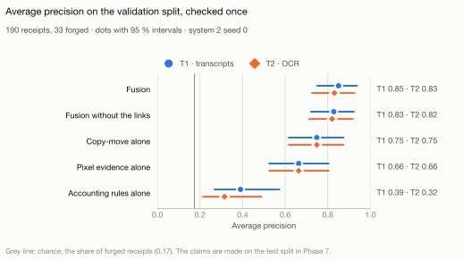

# Phase 5 results: combining the evidence

This page summarises Phase 5 and links the generated reports behind every number. It is written
by hand; when a number here and a generated report disagree, the generated report is right.

## Results on the validation split

The system was frozen at one commit and checked once on the 190 validation receipts, 33 of them
forged ([report](validation-check.md)). Every model was fitted on the training split; Platt
scaling and the thresholds, the review policy's among them, were set on the validation receipts,
and Phase 7 applies them unchanged to the test split. This is a check: the claims are made on the test split
by the same rules, as [ADR-0029](../../docs/decisions/0029-fusion-preregistration.md) fixes.

<picture>
  <source media="(prefers-color-scheme: dark)" srcset="figures/validation-precision-dark.svg">
  
</picture>

The figure is drawn by `make figures` from the check's run record; the report's ablation tables
are its table view.

- **Fusion beats every single source (RQ2, as a check).** Fusion reaches an average precision of
  0.851 on the transcripts (T1) and 0.831 on OCR text (T2), against a chance level of 0.174. The
  rule fixed in advance needs it to beat each single source, each by a paired-bootstrap
  interval above zero; it holds on both tracks. The narrowest margin is over copy-move: 0.102
  (0.031 to 0.186) on T1 and 0.083 (0.023 to 0.154) on T2.
- **Linking adds little that can be shown.** The fusion model against the same model without
  the two link inputs, the secondary comparison, gains 0.022 (0.0002 to 0.048) on T1 and 0.011
  (−0.011 to 0.035) on T2: at the edge of zero on one track, not above it on the other. Out of
  fold on the training split the differences were −0.003 and −0.001.
- **The review policy sends forgeries to review.** At the 10 % budget it sends 19 of the 190
  receipts to review on each track, and all 19 are forged: recall 19 of 33, the most this
  budget allows, and an exact 95 % interval for the precision of 0.824 to 1. At 20 % it finds 25
  of the 33. Rejecting a receipt stays a reviewer's decision.
- **The audit report points at the forgery.** The first region a report shows hits an annotated
  edit or copy source on 30 of the 33 forged receipts, where a random box of the same size hits
  about 5 % of the time; among the receipts sent to review it hits 19 of 19. Every one of the
  380 reports is grounded: an independent checker found each of their 16,496 numbers and boxes
  in the evidence.
- **Copy-move carries the copy-paste forgeries.** It is the largest contributor on 17 of the 26
  receipts forged by copy-paste within the receipt (T1). Forgeries that change only what the
  accounting rules cannot check, such as a date or the merchant, stay hard: fusion finds 4 (T1)
  or 5 (T2) of these 14 at the 10 % budget.
- **The file-metadata check is a shortcut, reported apart.** Alone it reaches 0.950, and with
  the T2 inputs 0.992 (track T3). Saving the file again removes the traits it reads, so T3 enters
  no claim ([ADR-0003](../../docs/decisions/0003-content-only-headline.md)).

### Limits of these results

- 33 forged receipts give wide intervals; F1, Brier score and expected calibration error are
  measured where Platt scaling and the thresholds were fitted, and are unbiased only on the
  test split.
- The training split was used to develop and to fit the system, and its out-of-fold numbers
  were optimistic: fusion 0.906 and 0.905 there, against 0.851 and 0.831 here
  ([training report](training-oof.md)).
- The validation split was not untouched before this check: Phase 3 measured the accounting
  rules on it once, Phase 4 chose thresholds on it, and Phase 5 counted its labels for group
  sizes and had the LLM read its fields once, without showing a field or a score
  ([ADR-0029, disclosures](../../docs/decisions/0029-fusion-preregistration.md#disclosures)).
- Copy-move relies on lossless files. Track R of Phase 7, which saves the test images again as
  JPEG, will show how much of it survives.
- Fitted on the training split, the fusion model was over-confident here (Platt slopes 0.83 and
  0.78); the calibration fitted here corrects that for the test split.

## How Phase 5 got there

| Step | What | Records and reports |
|---|---|---|
| Pre-registration | Fixed before any fusion input existed: the sources, the links, the model, the claims, the policy, the report, track T3 and the order of work | [ADR-0029](../../docs/decisions/0029-fusion-preregistration.md), [data behind it](preregistration-data.md), [copy-move feasibility](copy-move-feasibility.md) |
| Copy-move | Developed on the design fold, frozen, then measured once on the clean folds: average precision 0.860 (chance 0.167), and its pair hits the edit on 81 % of the forged receipts against a baseline of 5 % | [ADR-0030](../../docs/decisions/0030-copy-move-reports-a-pair.md), [development](../../docs/copy-move-development.md), [development report](copy-move-development.md), [clean measurement](copy-move-clean.md) |
| The system | Findings of every detector, two kinds of link, the fusion model, the review policy, the audit report and its grounding check | [architecture](../../docs/architecture.md), [`docfraud.fusion`](../../src/docfraud/fusion/), [`docfraud.reporting`](../../src/docfraud/reporting/) |
| Training split, out of fold | The development reference: every table of ADR-0029 on the 562 training receipts, labelled optimistic | [training report](training-oof.md) |
| Freeze | System 2 trained on the whole training split; the validation inputs computed once from the frozen commit and compared with the training inputs without labels | [learned models](../../docs/learned-models-development.md), [input comparison](input-shift.md), [its method](input-shift-method.md), [the rules' shift](input-shift-rules.md) |
| Validation check | Made once from a clean commit | [report](validation-check.md) |

Two findings on the way:

- **The inputs looked the same on both splits, except the rules' score.** It differed because a
  training receipt's score comes from the scorer of its fold, one of five, and a validation
  receipt's from one scorer: scored by that one scorer, the training receipts show no shift
  (KS distance 0.05, p 0.63 and 0.68). This diagnostic was made after the comparison and
  changes nothing.
- **Defects found in review were fixed before any clean number existed**, and recorded: the
  copy-move detector now confirms every match pixel by pixel, and its random baseline draws one
  box per region ([development record](../../docs/copy-move-development.md)).

## What comes next

Phase 6b adds the language-model layer: an agent that prepares a case file for each receipt sent
to review, and a language model used alone as a detector for comparison, with their cost and
latency. Phase 7 then unlocks the test split once for the claims, measures robustness to
re-saved images, analyses the errors, adds a model card and a demo, and publishes the
repository.

## Reproducing

```bash
make fusion-preregistration                          # data behind ADR-0029 and the shift method
uv run python experiments/copy_move_development.py    # copy-move-development.md
uv run docfraud copy-move report                     # copy-move-clean.md (from its record)
make whole-training                                  # system 2 on the whole training split (Apple GPU)
uv run docfraud fusion training-inputs               # training inputs, out of fold
uv run docfraud fusion training-oof                  # training-oof.md
uv run docfraud fusion input-shift-report            # input-shift.md (from its record)
make fusion-diagnostics                              # input-shift-rules.md
uv run docfraud fusion validation-report             # validation-check.md (from its record)
make figures                                         # figures/ (from the records)
```

The validation inputs, their comparison and the check were made once from the frozen system;
`validation-inputs`, `input-shift` and `validation-check` now refuse to run again, and their
reports are rendered from the records.
